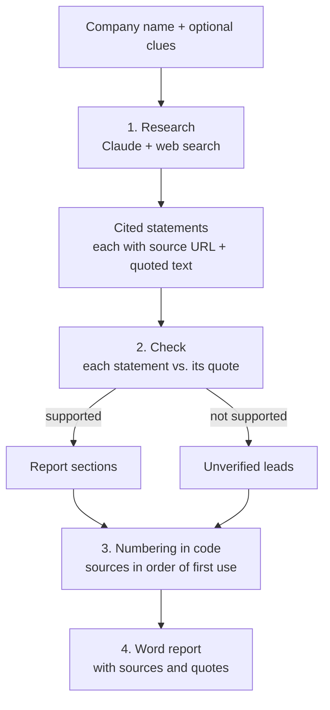

# Client Research Assistant

**Status:** Working prototype. Built with AI-assisted development; the workflow design, prompts and review step are mine.

Type in a company name, plus any clues you have (a website, a contact's email or phone number, where you met). The tool uses Claude with web search to research the company, checks every statement against the source text it came from, and writes a Word report. Each statement in the report has a number like `[3]`, and source 3 at the end gives the page title, the link and the exact sentence quoted from that page, so any fact can be checked against its source. Anything that couldn't be confirmed is listed separately instead of being guessed.

## Why I built it

I do part-time business development for a Chinese construction-materials exporter. Every time we looked at a new prospect, I repeated the same steps: search the company, read through the results, pull out what mattered, and write it up for the team. The steps never changed; only the company did.

Two things made it slower than it should be. Many of our prospects are small firms with a thin website, so the useful facts are spread across company registries, trade directories and the odd news story. And search results are often incomplete or out of date, so whatever I wrote up had to be checked again before anyone relied on it.

So I turned the routine into a workflow. I care most that the report is right, not that it is complete: every statement has to point to a quoted source, and gaps are stated plainly.

## How it works



1. **Research.** One Claude call with Anthropic's web search tool. Claude chooses its own searches (8 at most by default). It uses the clues to pin down the right company: an email domain points to the website, a phone code to the country. It then checks the official company register, the company's own site and recent news. The API attaches citations to the text, each with the source URL and the quoted sentence. Every cited sentence becomes a *claim*; text without a citation (introductions, commentary) is dropped.
2. **Check.** A second Claude call, without web access, compares each claim with its quoted text. Supported claims are arranged into fixed sections; claims whose quote doesn't back them up (a different number, a different company) go to "Unverified leads" with the reason.
3. **Numbering.** The check step may only refer to claim IDs. The code turns those IDs into `[n]` numbers, so the model cannot invent a citation or point one at the wrong page. A sentence with no valid claim behind it is removed, and the report says how many were removed.
4. **Export.** A `.docx` containing: summary and confidence level, *Identity & verification*, *Business & products*, *Scale & locations*, *Recent activity*, *Risks & red flags*, unverified leads, information gaps, suggested next steps, and the numbered sources with their quotes, the searches that were run and a footer disclaimer. Reports can be written in English or Chinese.

## Quick start

Python 3.11 or newer.

```bash
git clone https://github.com/alvinz26/client-research-assistant.git
cd client-research-assistant
python -m venv .venv
# Windows: .venv\Scripts\activate    macOS/Linux: source .venv/bin/activate
pip install -r requirements.txt
```

**Try it without a key (demo mode).** With no API key set, the full workflow runs on built-in sample data about a fictional company. Every demo output is labelled DEMO, including a red banner in the Word file.

```bash
streamlit run app.py
```

**Use it for real.** Copy `.env.example` to `.env` and add an [Anthropic API key](https://platform.claude.com/). Web search must be enabled for your organisation in the Claude Console (it is by default).

```bash
streamlit run app.py
# or from the command line:
python cli.py "Company name" --website example.com --location "Leeds, UK" --email buyer@example.com --lang en
```

Reports are saved in `outputs/`. Tests run offline with no key: `pytest`.

## Configuration

Set in `.env` (see `.env.example`):

| Variable | Default | Meaning |
|---|---|---|
| `ANTHROPIC_API_KEY` | (empty) | Your API key. Without it the app runs in demo mode. |
| `ANTHROPIC_MODEL` | `claude-sonnet-5-5` | Model for both calls. `claude-haiku-5-5` costs far less per token; I haven't compared report quality between the two. |
| `MAX_SEARCHES` | `8` | Maximum web searches per report. |
| `DEMO_MODE` | `0` | Set to `1` to use the sample data even when a key is set. |
| `OUTPUT_DIR` | `outputs` | Where reports are saved. |

## Design choices

More detail in [DECISIONS.md](DECISIONS.md).

- **Accuracy over completeness.** A short report that is right is more useful than a full one that has to be re-checked. The prompts tell Claude to state only what a source says.
- **Every statement is traceable.** Citation numbers are assigned by code from the API's citation data, never written by the model, and each source lists the exact text quoted from it.
- **Gaps are reported, not filled.** "Information gaps" and "Unverified leads" show what couldn't be confirmed, so the reader knows where to look next.
- **Automatic check, then a human check.** The check step catches statements that go beyond their quote before the report is written. The person reading the Word file is the final check, and the quotes beside each source make that quick.
- **Research the company, not the person.** Contact details are used only to identify the company; the prompts tell Claude not to look into the individual.
- **Prompts in one file.** All instructions live in `research/prompts.py`, so the method can be tuned without touching the code.
- **Demo mode.** Anyone can run the full workflow without a key. The sample company is fictional, uses `.example` web addresses, and is always shown whatever name is typed in, so no invented facts get attached to a real company.

## Project structure

```
app.py                  Streamlit page: form -> progress -> summary + download
cli.py                  Command-line version
research/
  config.py             Settings from .env, cost estimate
  prompts.py            All prompt text and report headings
  claude_client.py      The two API calls, citation parsing, error messages
  pipeline.py           Workflow and the traceability rules (build_report)
  report.py             Word document writer (English / Chinese)
  models.py             Plain data classes shared by every step
  demo.py               Fictional sample data for demo mode
tests/                  Offline tests: demo flow, mocked live path, parsing, report rules
samples/                Example output
DECISIONS.md            Design trade-offs
```

## Limitations

- It only knows what web search finds. Registers that need a login or are not indexed won't appear, and very small firms may come back with little more than gaps.
- Quotes are short (up to about 150 characters), so a statement can be supported by its quote but lack context. Follow the link when a fact matters.
- A source can itself be wrong or out of date, for example a company describing itself on its own site. Each source shows its type (official record, company's own site, third party) and its page date when one is available.
- The check step rewords statements and can still shift their meaning. The quote beside each source is there so this can be spotted.
- A live run is not instant: the searches run one after another before the check step starts. There is no caching and no history of past reports.
- The company name and any contact details you enter are sent to the Anthropic API. Don't enter anything you aren't allowed to share.

## Cost

*Estimate, not a measurement.* With the default model, a report costs roughly **US$0.25-0.50**: web search is $10 per 1,000 searches (so up to $0.08 for 8 searches), and search results are billed as input tokens at Sonnet 5.5 rates ($2 / $10 per million input / output tokens). `claude-haiku-5-5` is much cheaper per token. The app and CLI show an estimate for each run, based on the token counts the API reports.
