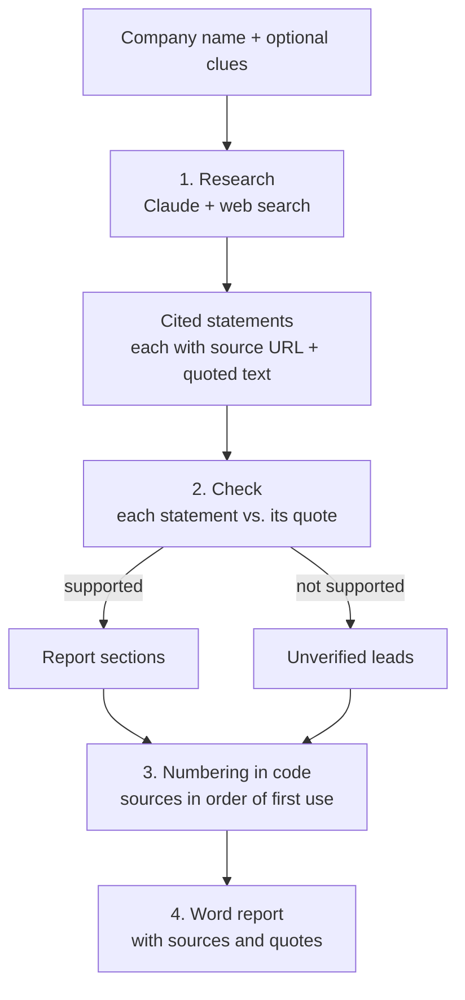

# Client Research Assistant

**Status:** Working prototype. Built with AI-assisted development; the workflow design, prompts and review step are mine.

Type in a company name, plus any clues you have (a website, a contact's email or phone number, where you met). The tool uses Claude with web search to research the company, checks every statement against the source text it came from, and writes a Word report. Each statement in the report has a number like `[3]`, and source 3 at the end gives the page title, the link and the exact sentence quoted from that page, so any fact can be checked against its source. Anything that couldn't be confirmed is listed separately instead of being guessed.

## Why I built it

I do part-time business development for a Chinese construction-materials exporter. Every time we looked at a new prospect, I repeated the same steps: search the company, read through the results, pull out what mattered, and write it up for the team. The steps never changed; only the company did.

Two things made it slower than it should be. Many of our prospects are small firms with a thin website, so the useful facts are spread across company registries, trade directories and the odd news story. And search results are often incomplete or out of date, so whatever I wrote up had to be checked again before anyone relied on it.

So I turned the routine into a workflow. I care most that the report is right, not that it is complete: every statement has to point to a quoted source, and gaps are stated plainly.

## How it works



1. **Research.** One Claude call with Anthropic's web search tool. Claude chooses its own searches (8 at most by default). It uses the clues to pin down the right company: an email domain points to the website, a phone code to the country. It then checks the official company register, the company's own site, its customers and recent news. It reads up to three key pages in full with the web fetch tool, so quotes from those pages are complete sentences rather than short snippets. Personal profile pages (`linkedin.com/in`) are blocked at the tool level. The API attaches citations to the text, each with the source URL and a quote from the page. Statements are written in English whatever the language of the source; the quotes stay in the original language. Every cited sentence becomes a *claim*; the API often cites only part of a sentence, so the claim is widened to the whole sentence. Text without a citation (introductions, commentary) is dropped.
2. **Check.** A second Claude call, without web access, compares each claim with its quoted text. Supported claims fill a fixed set of fields and tables. If a quote is cut off, only the part it shows is used. Claims whose quote doesn't back them up go to "Unverified leads" with the reason, written in the report language; claims about a different company with a similar name are listed in one line, so they can't be mixed up with the right one.
3. **Numbering.** The check step may only refer to claim IDs. The code turns those IDs into `[n]` numbers, so the model cannot invent a citation or point one at the wrong page. Text with no valid claim behind it is removed, and the report says how many were removed.
4. **Export.** A compact `.docx`, usually one to two pages:
   - a bottom line and a confidence level;
   - a key-facts table (what they do, business type, location, registration, customers and markets, size, identity check), with *Not found* wherever nothing was confirmed;
   - product, recent-activity and risk tables;
   - unverified leads;
   - information gaps and suggested next steps, side by side;
   - the numbered sources, each with its type, page date, link and the quotes it supports.

   Reports can be written in English or Chinese.

An example report, made in demo mode about a fictional company, is in [`samples/`](samples/).

## Quick start

You need [Python 3.11 or newer](https://www.python.org/downloads/). On Windows, tick "Add python.exe to PATH" when installing.

1. Download the project: **Code → Download ZIP** on GitHub, then unzip it (or `git clone` it).
2. Double-click **`start.bat`** (Windows) or **`start.command`** (macOS). The first run installs everything it needs, which takes a few minutes. After that the page opens in your browser at `http://localhost:8501`. Keep the small window open while you use the app.
   - On macOS, if the file is blocked as being from an unidentified developer, right-click it and choose **Open**.
3. **Try it without a key.** The page starts in demo mode: the full workflow runs on built-in sample data about a fictional company. Every demo output is labelled DEMO, including a red banner in the Word file.
4. **Use it for real.** Paste an [Anthropic API key](https://platform.claude.com/) into the sidebar and click **Save key**. The key is first checked for free, then saved in a local `.env` file; you won't need to enter it again. `.env` is in `.gitignore`, so it is never uploaded. **Remove saved key** deletes it. Web search must be enabled for your organisation in the Claude Console (it is by default).

The key-saving sidebar is meant for running on your own computer. Don't deploy this page to a public server as it is.

**From a terminal** (optional):

```bash
python -m venv .venv
# Windows: .venv\Scripts\activate    macOS/Linux: source .venv/bin/activate
pip install -r requirements.txt
streamlit run app.py
# or without the page:
python cli.py "Company name" --website example.com --location "Leeds, UK" --lang en
```

Reports are saved in `outputs/`. Tests run offline with no key: `pytest`.

## Configuration

Set in `.env` (see `.env.example`). The sidebar writes the key for you; the other settings are edited by hand.

| Variable | Default | Meaning |
|---|---|---|
| `ANTHROPIC_API_KEY` | (empty) | Your API key. Without it the app runs in demo mode. |
| `ANTHROPIC_MODEL` | `claude-sonnet-5-5` | Model for both calls. `claude-haiku-5-5` costs far less per token; I haven't compared report quality between the two. |
| `MAX_SEARCHES` | `8` | Maximum web searches per report. |
| `DEMO_MODE` | `0` | Set to `1` to use the sample data even when a key is set. |
| `OUTPUT_DIR` | `outputs` | Where reports are saved. |

## Design choices

More detail in [DECISIONS.md](DECISIONS.md).

- **Accuracy over completeness.** A short report that is right is more useful than a full one that has to be re-checked. The prompts tell Claude to state only what a source says.
- **Every statement is traceable.** Citation numbers are assigned by code from the API's citation data, never written by the model, and each source lists the exact text quoted from it.
- **Gaps are reported, not filled.** "Information gaps" and "Unverified leads" show what couldn't be confirmed, so the reader knows where to look next.
- **Automatic check, then a human check.** The check step catches statements that go beyond their quote before the report is written. The person reading the Word file is the final check, and the quotes beside each source make that quick.
- **Research the company, not the person.** Contact details are used only to identify the company. The search tool blocks personal profile pages, and the check step refers to people other than the named contact by role, not by name.
- **Prompts in one file.** All instructions live in `research/prompts.py`, so the method can be tuned without touching the code.
- **Demo mode.** Anyone can run the full workflow without a key. The sample company is fictional, uses `.example` web addresses, and is always shown whatever name is typed in, so no invented facts get attached to a real company.

## Project structure

```
start.bat, start.command  Double-click launchers (Windows, macOS)
app.py                  Streamlit page: form -> progress -> summary + download; key setup in the sidebar
cli.py                  Command-line version
research/
  config.py             Settings from .env, cost estimate
  prompts.py            All prompt text and report headings
  claude_client.py      The two API calls, citation parsing, error messages
  pipeline.py           Workflow and the traceability rules (build_report)
  report.py             Word document writer (English / Chinese)
  models.py             Plain data classes shared by every step
  demo.py               Fictional sample data for demo mode
tests/                  Offline tests: demo flow, mocked live path, parsing, report rules
samples/                Example report (demo mode, fictional company)
DECISIONS.md            Design trade-offs
```

## Limitations

- Full-page reading doesn't work on pages that need JavaScript to show their content, so those still rely on short search snippets.
- It only knows what web search finds. Registers that need a login or are not indexed won't appear, and very small firms may come back with little more than gaps.
- Quotes are short (up to about 150 characters), and some are cut off before the part that matters. Because the check step is strict, true statements can end up under "Unverified leads". A statement can also be supported by its quote but lack context. Follow the link when a fact matters.
- A source can itself be wrong or out of date, for example a company describing itself on its own site. Each source shows its type (official record, company's own site, third party) and its page date when one is available.
- The check step rewords statements and can still shift their meaning. The quote beside each source is there so this can be spotted.
- A live run is not instant: the searches run one after another before the check step starts. There is no caching and no history of past reports.
- The company name and any contact details you enter are sent to the Anthropic API. Don't enter anything you aren't allowed to share.

## Cost

Three runs with the default model each cost about **US$0.25-0.40** and took **1-2 minutes**:

| Run | Searches | Input / output tokens | Estimated cost | Time |
|---|---|---|---|---|
| Run 1 | 7 | 122k / 7k | $0.39 | 58 s |
| Run 2 | 6 | 61k / 7k | $0.25 | 51 s |
| Run 3 | 2 (+3 pages read) | 91k / 14k | $0.35 | 103 s |

These costs are estimates calculated from the token counts the API reported, at $2 / $10 per million input / output tokens plus $10 per 1,000 searches; they are not taken from an invoice. Most of the input tokens are search results. The first two runs were made before full-page reading was added. Three runs are not a benchmark, and costs will vary with the company. `claude-haiku-5-5` is much cheaper per token. The app and CLI show the same estimate after every run.

## License

MIT. See [LICENSE](LICENSE).
